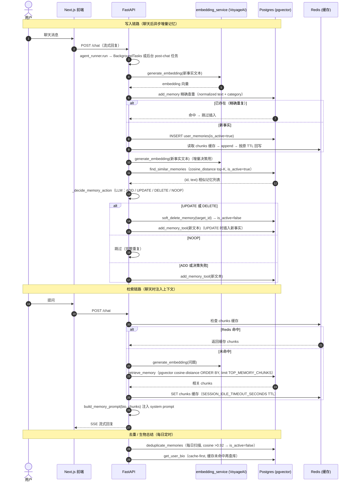

# Architecture — LifePilot

This document explains the system design, data flow, agent orchestration, memory, proactive scheduling, and infrastructure decisions behind LifePilot, the personal AI multi-agent life automation manager built on the Chief of Staff project.

---

## System Overview

LifePilot is a planner/supervisor multi-agent pipeline. A user request enters the frontend chat or a LifePilot dashboard surface, is classified and decomposed into dependency-aware steps, and those steps run in parallel where possible. Results are supervised, blocked steps are replanned, and planned tasks, reminders, life-service calls, memories, and notifications are persisted for later use.

```
User (voice/text)
      │
      ▼
 Next.js Frontend (/life-pilot dashboard + chat)
      │
      ▼
 FastAPI Backend
      │
      ▼
 LangGraph: orchestrate → planner → parallel fan-out
      │
      ├──► email_agent        (163 邮箱 IMAP/SMTP, legacy Gmail fallback)
      ├──► calendar_agent     (Google Calendar)
      ├──► notion_agent       (Notion)
      ├──► life_agent         (weather / map)
      └──► direct_reply       (no tool route)
                │
                ▼
          supervisor
                │  ├─ more ready tasks → planner/fan-out again
                │  ├─ blocked step  → planner replan loop
                │  └─ all done     → merge_results → END
```

---

## Component Breakdown

### 1. Frontend — `frontend/`

Built with Next.js App Router, Tailwind CSS, and React Query.

- **Chat** streams agent output through the conversation UI and supports composer pre-fill from LifePilot dashboard starter buttons via the `q` query parameter.
- **LifePilot dashboard** (`/life-pilot`) surfaces upcoming meeting invitations, pending reminders, long-term memory, life preferences, and persisted weather/map service calls. It updates through `useLifePilotBundle`, which fetches `/life-preferences`, `/life-services`, `/meeting-invites`, `/reminders`, and `/memory` in parallel.
- **Tasks/calendar/notifications/background jobs** remain available as first-class workspaces.
- `authenticatedFetch` and client-side session state gate every API call behind the user's JWT.

### 2. Backend — `backend/`

Built with FastAPI and SQLAlchemy async.

- **Chat** accepts messages and runs them through the agent graph with a database session and persisted conversations.
- **Routers** cover auth, chat, voice, 163 邮箱, Gmail (legacy), Calendar, Notion, notifications, background jobs, tasks, reminders, life preferences, life services, memory, meeting invites, Tencent Meeting, and entity creation.
- **163 邮箱登录** — `GET /mail163/login` 使用 `MAIL163_EMAIL` + `MAIL163_EMAIL_AUTH_CODE` 通过 IMAP 校验，复用邮箱地址创建/获取用户并签发 JWT；`GET /mail163/status` 返回配置状态，`POST /mail163/disconnect` 清理本地缓存。
- **Startup** initializes the database engine, Redis, VoyageAI embeddings, optional schema-migration helpers, and APScheduler. During development, `INIT_DB_SCHEMA_ON_STARTUP=true` runs `Base.metadata.create_all` plus the background-job, task-column, and LifePilot schema migrations.
- **Background scheduler** runs a one-minute tick that processes due recurring jobs and due reminders, plus a daily 03:00 bio-summarization job.

### 3. Agent Orchestration — `agents/`

Built with LangGraph `StateGraph`.

#### State — `agents/state.py`

Shared blackboard fields include:

- `user_id`, `db_session`, `settings`, `messages`, `memory_context`
- `tasks` (planner steps), `current_task`, `plan`
- `agent_results` (merged via `operator.add`)
- `completed_task_ids`, `supervisor_decision`, `final_answer`, `error`
- **Fact-store fields (first-class State, not history)** — `core_intent`, `step_results`, `pending_actions`. These carry the *facts* of a turn; `messages` carries only the *narrative*. See §10.

#### Graph — `agents/graph.py`

`build_graph(llm, checkpointer=...)` creates:

```
orchestrate → planner → [Send fan-out — one ready dependency layer at a time]
                         ├── email_agent
                         ├── calendar_agent
                         ├── notion_agent
                         ├── life_agent
                         └── direct_reply
                                    │
                               supervisor
                                    │  ├─ continue → planner/fan-out
                                    │  ├─ replan   → planner
                                    │  └─ done     → merge_results → END
```

The fan-out returns only the next dependency layer via `task_layers` / `is_ready`, so later steps are not started until their dependencies complete.

#### Planner — `agents/planner_agent_node.py`

- Detects requests that need multi-step planning using multi-step terms and planning verbs (English + Chinese).
- Prompts the LLM for a JSON plan with `plan_id`, `summary`, and steps (route, priority, `depends_on`, optional `due_at`).
- Validates routes (`email`, `calendar`, `notion`, `direct`, `life`), priorities, dependencies, and caps at 8 tasks.
- Persists each step as a `Task` with `project="LifePilot"`, `plan_source="planner"`, `plan_id`, `source_metadata={"planner": "life_pilot", ...}`, and schedules a deadline reminder when `due_at` is set.
- Skips re-persisting when the supervisor is continuing an existing plan (state already has `plan` and `tasks`).
- **Deterministic dependency injection** — the LLM frequently plans "查天气 → 根据天气写邮件"
  as two *independent* steps. Without a `depends_on` edge, `_blocked_downstream` has nothing
  to traverse, so a failed weather step does not stop the email step. `_UPSTREAM_REFERENCE_RE`
  detects "根据/结合/基于…天气/结果/内容…" in a downstream intent and forces it to depend on
  every earlier data-producing step (`life`/`notion`/`calendar`/`email`).
- Falls back to a single `direct` step on LLM parse failure.
- **Travel expansion** (`agents/travel_planning.py`) — "去上海玩两天" used to be classified
  `direct`, so the planner bailed out early and `merge_results` only had one branch (a
  hand-written guide). `is_travel_request` now keeps the planner engaged and
  `expand_travel_tasks` replaces the single direct step with three **dependency-free** life
  steps (weather / sights / transport). They fan out through the existing `_fan_out`
  (`Send`) and every result reaches `merge_results`, which appends `TRAVEL_SYNTHESIS_RULES`
  and a deterministic weather-advice footer (umbrella / clothing) computed from the real
  weather branch output. `graph.py` is untouched — no new nodes, no new edges.

#### Supervisor — `agents/supervisor_node.py`

- Marks completed tasks, detects failed task results, and decides:
  - `continue` → feed the next ready dependency layer
  - `replan` → increment iteration, retry blocked step (bounded by `planner_max_iterations`)
  - `done` → merge results into a final answer
- Uses `task_key` + `attempt` to avoid stale failure data from earlier attempts.
- **Fatal abort (`fatal_error`)** — a step that reports `fatal_error: True` (target place
  does not exist) short-circuits everything: no replan, downstream steps dropped, `done`
  returned immediately. Checked **before** the replan branch, because replanning the same
  impossible target is not just useless — it strips the city out of the intent and lets the
  default-city fallback answer with 上海's weather.
- **Downstream blocking (`_blocked_downstream`)** — when a step fails, every task whose
  `depends_on` transitively reaches it is dropped from the plan so `_fan_out` can never
  execute it on missing/wrong data. On a non-fatal failure, dropping happens **only when the
  replan budget is exhausted**; while replans remain the downstream steps are kept so a
  rebuilt plan can still use them. Each dropped step emits a `blocked_step_notices` entry —
  "「写邮件」已暂停：上游「查天气」没有拿到数据…是否取消「写邮件」？" — appended verbatim
  to the final answer (never summarized by the merge model). This is the fix for the
  "火星天气查不到，却用别处数据写了邮件" class of DAG data pollution.
  Blocking can only work when the dependency edge exists, which is why the planner injects
  one deterministically (see below) instead of trusting the LLM to emit `depends_on`.

#### Domain Agents

- `email_agent_node` — 163 邮箱 context and operations via IMAP/SMTP (legacy Gmail fallback)
- `calendar_agent_node` — Google Calendar context and operations
- `notion_agent_node` — Notion search/read/write
- `life_agent_node` — weather/map lookups via `LifeTool`
- `direct_reply_node` — no-tool replies
- `merge_results_node` — final synthesis. Three deterministic wrappers are applied around
  whatever the merge model returns, so they cannot be "forgotten" by the LLM:
  - `emotional_comfort_prefix` — when the latest user message expresses distress
    ("心情崩溃"、"压力很大"、"想哭"), one empathy line ("抱抱你，先深呼吸…") is prepended.
    It is only an opener: the weather/schedule answer still follows in full.
  - `_blocked_footer` — renders `blocked_step_notices` verbatim as "**已暂停的步骤：**"
    so a skipped downstream step always reaches the user with its "是否取消「X」？" question.
  - `_conflict_footer` — renders `schedule_conflicts` as "时间冲突：你在这个时段已有【XXX】".

#### 一图看懂：几个规划器？谁分发？谁汇总？

**先回答三个问题：**

1. **规划器（Planner）只有一个** —— `agents/planner_agent_node.py` 里的 `planner_node`。
   但它会在三个时机被触发，所以"看起来像有三个"：初次拆解、监督代理要求重试、监督代理要求重新规划。
2. **分发任务的是编排器（Orchestrator）** —— `agents/orchestrator_node.py` 的 `orchestrate_node` 负责"听懂并分类"，
   真正把任务发出去的是 `agents/graph.py` 的 `_fan_out`（调用 LangGraph 的 `Send` 并行派发）。
3. **汇总由三步接力完成** —— 各代理的结果先由状态里的 `operator.add` 自动拼接（Reducer），
   再由 `supervisor_node` 判断"齐了没、要不要重试"，最后由 `merge_results_node` 写成一段完整回答。

**一张图：**

```
                         用户说一句话
                              │
                              ▼
        ┌─────────────────────────────────────────┐
        │ ① 编排器 orchestrate_node               │
        │   「听懂」：把这句话拆成 1~5 个意图     │
        │   例如：查邮件 + 明早9点提醒            │
        │   输出：[{intent, route}, ...]          │
        └──────────────────┬──────────────────────┘
                           │  意图清单
                           ▼
        ┌─────────────────────────────────────────┐
        │ ② 规划器 planner_node（唯一的 Planner）  │
        │   「排计划」：给每个意图补上             │
        │   依赖关系 depends_on、优先级、截止时间  │
        │   并把需要看的步骤落库成任务卡片         │
        └──────────────────┬──────────────────────┘
                           │  带依赖的计划
                           ▼
        ┌─────────────────────────────────────────┐
        │ ③ 分发 _fan_out（真正的"派活"）          │
        │   只放行"依赖都已完成"的那一层，         │
        │   同一层用 Send 并行跑                   │
        └───┬─────────┬─────────┬────────┬────────┘
            │         │         │        │
            ▼         ▼         ▼        ▼
        ┌───────┐ ┌────────┐ ┌──────┐ ┌──────────┐ ┌───────────┐
        │ email │ │calendar│ │notion│ │  life    │ │direct_reply│
        │ 代理  │ │  代理  │ │ 代理 │ │ 代理     │ │ 普通对话   │
        └───┬───┘ └───┬────┘ └──┬───┘ └────┬─────┘ └─────┬─────┘
            │         │         │          │             │
            └─────────┴─────────┴──────────┴─────────────┘
                           │ 各自结果写进 agent_results
                           │ （operator.add 自动拼接 ← Reducer）
                           ▼
        ┌─────────────────────────────────────────┐
        │ ④ 监督代理 supervisor_node              │
        │   检查：每步成功还是失败？              │
        │   还有下一层 → 回 ②（规划器直接放行）→ ③ 继续分发 │
        │   有步骤失败 → 回 ② 重新规划（有次数上限）│
        │   全部完成   → 去 ⑤                      │
        └──────────────────┬──────────────────────┘
                           │
                           ▼
        ┌─────────────────────────────────────────┐
        │ ⑤ 汇总 merge_results_node               │
        │   把各分支结果合成一段连贯的中文回答      │
        │   只有 1 个结果时直接透传，不再调模型     │
        └──────────────────┬──────────────────────┘
                           ▼
                       回复用户
```

**几个容易混的点：**

| 你可能想问 | 实际是谁 |
| --- | --- |
| 是谁决定"这句话是查邮件还是查天气"？ | 编排器 `orchestrate_node`（意图分类） |
| 是谁把任务真正派给各个代理？ | `graph.py` 的 `_fan_out`，用 LangGraph `Send` 并行分发 |
| 是谁把几个代理的答案拼成一句话？ | `agent_results` 的 `operator.add` 先拼接，`merge_results_node` 最后成文 |
| 失败了谁来兜底？ | 监督代理 `supervisor_node`，它会让规划器重来，超过上限就带着错误信息去汇总 |
| 规划器有几个？ | 一个（`planner_node`），被初次规划、重试、重新规划三种情况复用 |

**为什么这么设计：** 编排器只管"听懂"，规划器只管"排计划"，代理只管"干一件事"，
监督代理只管"验收"。四者的职责互不重叠，所以任何一步出问题都能单独定位、单独重试，
而不会把整条链路推倒重来。

### 4. Proactive Tasks, Reminders, and Scheduling

**Reminders** (`services/reminder_service.py`, `jobs/reminder_tick.py`):

- `schedule_deadline_reminder` creates an idempotent per-task+due deadline reminder (default 30 minutes before due).
- Meeting invites create `MEETING` reminders; upserts reschedule the existing reminder when the invite changes.
- The one-minute APScheduler tick calls `get_due_reminders` (with `FOR UPDATE SKIP LOCKED`), creates a `UserNotification` per due reminder, and marks it `SENT`.

**Background jobs** (`services/background_job_service.py`):

- Cron-style schedules validated with APScheduler and converted to `next_run_at` in UTC.
- The tick advances the next run, ends past-window schedules, writes run history, and maps graph state to `SUCCESS`/`FAILED` outcomes.
- `build_traces_from_agent_state` produces UI-compatible execution traces without exposing raw chain-of-thought.

### 5. Long-Term Memory — `services/memory_service.py`, `services/long_term_preference_service.py`

Memory uses PostgreSQL (`pgvector`) plus Redis caching:

- **Add memory** — embed with VoyageAI, persist to `user_memories`, append to the session cache.
- **Retrieve** — Redis cache-first; on miss, run a pgvector cosine-distance search for the top chunks and cache session-scoped results.
- **Deduplicate** — soft-delete semantically duplicate memories above a cosine threshold.
- **Bio** — cache-first user bio, refreshed daily by `jobs/bio_summarization.py`.
- **Life preferences** — machine-readable habits, time preferences, work hours, priority rules, and raw notes, cached in Redis and invalidated on upsert, injected into planner context.

#### 5.1 Memory Data Flow



#### 约定

- **写入** — 聊天后走 `post_chat_memory_extraction`，先在 `add_memory` 做精确文本查重（防止“我喜欢拿铁”每天重复入库），再对新事实做 LLM 增量决策（ADD/UPDATE/DELETE/NOOP，Mem0 风格），失败时安全降级为普通 ADD。
- **一次性流水账闸门** — 落库前先过 `is_one_off_log`（`services/memory_noise_filter.py`）：单日词/带钟点的单次事件/单次消费动作一律跳过，Prompt 只是第一道防线，代码判定才是硬闸门。
- **确定性偏好替换** — 决策 LLM 对“我其实更喜欢喝美式”可能答 ADD（“两种都喜欢”也说得通）。`_deterministic_supersede_target` 在“显式替换词 + 同域唯一旧偏好”时强制 UPDATE 软删旧记忆，避免新旧偏好同时 active。
- **事实纠错必须真正失效旧记录（防止“假动作”）** — 用户说“不对 / 记错了 / 其实是 / 修改”时，`_deterministic_correction_target` 会在**用户原话**（抽取结果已被改写成客观陈述，纠错词只剩在原话里）中找纠错词，并与相似记忆比较“维度锚点”（领导/老板、生日、住址、公司、职位、电话、邮箱、学校）。命中唯一候选即强制 `UPDATE` → `soft_delete_memory(old_id)` + 插入新事实。绝不接受“在新记忆里写一句『之前张三作废』”这种只在文本里备注的假更新。
- **作废备注在落库前剥离** — `memory_service.strip_superseded_notes` 删掉“（之前张三作废）”这类括号/尾注。若备注留在文本里，检索会把已作废的张三重新注入上下文，等于没改；同时备注会提前污染 `find_similar_memories` 的相似度计算，所以剥离发生在**检索相似记忆之前**。
- **短期情绪不是长期记忆** — Prompt 有 `EMOTIONAL STATE — NEVER A LONG-TERM MEMORY` 段禁止抽取“今天心情崩溃 / 近期压力很大”；代码侧 `memory_noise_filter.is_transient_emotional_state` 是硬闸门（崩溃/情绪低落/焦虑/压力大/难过/失眠…），带循环词（每天）或长期词（长期/一直/确诊/在看医生）才放行。“用户近期情绪低落”这类记忆一旦入库，会每轮被检索注入，助手会永远把用户当成正在崩溃的人。
- **检索（三层兜底，绝不允许“库里有人、嘴里说没有”）** — `retrieve_memory` 依次尝试：
  1. **按 query 分片的缓存**：键是 `memory:user:{id}:chunks:{sha1(query)}`。旧实现只按 `user_id` 缓存，于是用户第一轮查天气的结果会被复用给之后 30 分钟内的每一次提问——问“你记得我领导吗”时模型看到的是天气记忆，只能回答“我没存过”。
  2. **向量检索**：pgvector 余弦距离，并加 `MAX_MEMORY_DISTANCE = 0.75` 阈值。没有阈值时任何 query 都能凑满 8 条，无关记忆会把真正相关的挤出去。
  3. **关键词检索**：CJK bigram + ASCII 词做 `ILIKE`。“领导”这类字面命中不依赖 embedding，向量服务限流/超时也照样能召回。
  两路结果**取并集**而不是“向量为空才兜底”——语义检索对“我领导叫啥”常把聊过的天气排前面，一旦非空就再也轮不到字面命中。最后再过滤一次 `is_transient_emotional_state`，一次性情绪永不进入上下文。
- **注入** — `build_memory_prompt` 以 `[LONG-TERM MEMORY — background knowledge about this user]` 开头，并写明三条硬规则：问“你知道/记得…吗”必须先看这里且不得否认；无关记忆保持沉默、不改变语气；矛盾时取新值不复述旧值。没有任何记忆时返回空串，不注入空标题（否则模型会假装记得）。
- **缓存失效** — 写入、软删除、去重、清洗脚本都走 `_clear_chunk_cache`（`SCAN` 前缀删除）。只改库不清缓存等于软删没生效：旧值还会被注入到 TTL 结束。
- **去重** — `deduplicate_memories` 按余弦相似度阈值软删除（`is_active=false`），保留时间上较新的代表记忆。
- **持久化** — Postgres 是唯一事实来源；Redis 只是低延迟缓存，任何缓存失效都会回源 Postgres，不会丢数据。

### 6. Cross-Scene Meeting Automation

**Meeting extraction** (`services/meeting_invite_extraction.py`):

- Deterministic regex extraction for meeting number, join URL, and absolute/relative times (Chinese `YYYY年M月D日 HH:MM` ranges are interpreted as UTC+8), with a structured LLM fallback.
- `POST /meeting-invites/from-email` joins extraction + persistence: creates or updates an invite by `external_id`, marks `found_in_email`, and schedules a pre-meeting reminder.

**Inbox scan → task board** (`services/meeting_invite_scanner.py`):

- `scan_mail163_inbox_for_meeting_invites` filters recent mail by invite keywords, extracts a real start time (no LLM required for the unattended path), upserts the invite by message id, and projects it onto exactly one task matched by `source_metadata->>'meeting_invite_id'`. A moved meeting refreshes the existing card instead of creating a duplicate.
- Triggered three ways: the APScheduler `meeting_invite_scan` job every 10 minutes, `POST /meeting-invites/scan-inbox`, and the `scan_meeting_invites` chat tool when the user asks to pull invites onto the board.

**Proactive inbox listener** (`services/inbox_listener.py`, `services/inbox_event_extraction.py`):

- Keyword templates miss social invitations ("周六一起吃个饭？"), so the same 5-minute scheduler tick also runs an LLM extractor over recent non-template mail. It returns `is_event / kind(meeting|social|appointment) / title / starts_at / location`; an event without an absolute start time is dropped rather than guessed.
- Hits become tasks (`邀约：` / `预约：` / `会议：` prefixes) plus a `Notification` so the user knows someone invited them. Messages that look like meeting templates are skipped here and stay owned by `meeting_invite_scanner`, so one email never yields two cards.
- Idempotency is keyed on the mail `Message-ID` (IMAP UID is not stable across re-sync): a 30-day Redis seen-key plus a Postgres lookup on `tasks.source_metadata->>'email_message_id'`. Each tick is capped at 8 LLM calls.
- Notification failures never roll back a created task.

**Task creation idempotency** (`services/idempotency_service.py`, `services/task_service.py`, `db/task_schema_migration.py`):

- Every creation path (chat, planner, tools, inbox listener, `POST /tasks`) goes through `create_task_for_user`. It first claims a Redis lock keyed on `user_id + title + due_at` (`SET NX EX 300`); a busy lock returns the already-created task instead of inserting.
- Backstop: a partial unique index `ux_tasks_user_title_due` on `(user_id, title, coalesce(due_at,'epoch'))` where `source <> 'system'`. Startup dedupes legacy rows inside a SAVEPOINT, then builds the index; a failure is logged and non-fatal.
- An `IntegrityError` on insert rolls back only the savepoint and returns the existing row, so concurrent planners never surface a 500.

**Tencent Meeting** (`routers/tencent_meeting.py`, `services/tencent_meeting_client.py`):

- Optional query/create/update via the Tencent Meeting REST API.
- Create uses an opt-in `idempotency_key`; provider config errors map to 503, API errors to 502.

### 7. Life Services — `services/life_service_client.py`, `routers/life_services.py`

- `get_weather` supports Open-Meteo by default, OpenWeatherMap when keyed, and **Amap (高德)** when `AMAP_API_KEY` is set.
- `get_map_context` supports Nominatim by default, Google Maps when keyed, and **Amap** when `AMAP_API_KEY` is set. Amap lookups use **POI keyword search** (`/v3/place/text`) first and fall back to geocoding, because geocoding only understands postal addresses and never resolves 景点 (上海博物馆/豫园).
- `get_route_planning` wraps Amap's walking / transit / driving direction endpoints and returns distance + duration for a coordinate pair.
- Every request is persisted to `life_service_requests`; optional `idempotency_key` avoids duplicate external calls.

#### 7.1 Amap provider

Mainland-China users get far better coverage from Amap than from Open-Meteo/Nominatim, and Chinese city names work directly without manual coordinates.

```
city / address / (lat, lon)
        │
        ├─ 6-digit adcode? ──────────────────► use as-is
        ├─ city name? ──► /v3/geocode/geo ────► adcode (+ cached)
        └─ coordinates? ─► /v3/geocode/regeo ─► adcode
                                    │
                                    ▼
                 /v3/weather/weatherInfo?city={adcode}
```

- `_resolve_amap_location` picks the adcode by input shape: a bare 6-digit code is used directly, a city name goes through forward geocoding, coordinates go through reverse geocoding, and the configured default city is the last resort.
- `_AMAP_GEOCODE_CACHE` (FIFO, max 256 entries) memoises only rows that actually carry an adcode, so repeated "上海天气" turns do not re-hit the geocoding API.
- Amap's envelope is `{"status": "1", "info": "OK", ...}`; a non-`"1"` status raises `LifeServiceError("amap", ...)` instead of returning a half-empty payload.
- Amap returns numeric fields as strings and city/province as `[]` when unknown — `_amap_text` / `_amap_int` / `_amap_float` normalise both cases.
- Weather maps to `provider / city / province / adcode / temperature_c / humidity / condition / wind_direction / wind_power / as_of_iso / raw`; map lookups return up to 3 places with `label / formatted_address / lat / lon / adcode / city / district`.
- The life agent strips filler words (`今天`, `天气`, `怎么样`) before geocoding, so "北京天气怎么样" resolves with city `北京` instead of a sentence.
- **Entity consistency (`requested_entity_mismatch`)** — a geocode hit is only accepted when the *requested* place appears in the resolved **administrative levels** (`province` / `city` / `district`), not merely in `formatted_address`. Amap happily fuzzy-matches "火星" to 贵州黔东南的「火星村」, which would let a weather lookup answer with another province's data. When the levels don't contain the requested name the client raises `LifeServiceError("...查不到「火星」这个地方（高德只匹配到「…火星村」）")`, which the life agent reports as `TASK_STATUS_FAILED` — so nothing downstream can consume it. Names longer than 3 characters are matched by their first and last 2 characters to tolerate 省/市/区 suffixes and abbreviations.
- **Fatal failures (`LifeServiceError(fatal=True)`)** — "the place you named does not exist" is not retryable and must not be papered over. `_resolve_amap_location` raises with `fatal=True` for an unparseable city, a rejected fuzzy match, and an entity mismatch. The life agent forwards `fatal_error: true` in its `agent_results`; `supervisor_node` then aborts the whole DAG immediately (no replan, downstream steps dropped) instead of retrying. Replanning is what silently deleted the city from the intent and let the default-city fallback answer with 上海's weather.
- **No default-city substitution** — the default city (`WEATHER_DEFAULT_CITY`, default Shanghai) is only used when the user named *no* place at all ("天气怎么样"). `_mentions_place` distinguishes that from "火星天气", where a place was named but could not be parsed; the latter fails loudly instead of answering for 上海.
- **City-scoped POI search** — `search_amap_places` sends `city=<会话城市>&citylimit=true`, so 「外滩」 no longer matches 武汉/福州. The city is passed as a structured parameter (never prepended to the keyword) and comes from the explicit tool argument or `core_intent.entities.destination`. When the POI endpoint fails the client logs and falls back to geocoding (also `city`-scoped), and the geocode cache is keyed on `city|address` — 人民广场 in 上海 and 南京 are different places.
- **Route planning** — `get_route_planning(origin_lat/lon, destination_lat/lon, mode, city)` normalises Amap's `"lon,lat"` ordering, parses `route.paths[0]` (walking/driving) or `route.transits[0]` (transit), and returns `distance_m / duration_s / duration_text / summary / steps`. Transit needs a city: an explicit argument wins, otherwise the origin is reverse-geocoded to supply `city` + `cityd`.
- **Itinerary → task** — `LifeTool` optionally mounts `create_task` when it has a DB session and `user_id` (the life agent now passes both), reusing `task_action_tools`. Task creation is idempotent (Redis lock + unique index), so a re-run of the same itinerary does not duplicate the card.

### 8. Reliability and Observability

- **Redis idempotency** — `check_idempotent` / `record_idempotent` wrap external write calls and life-service calls with 24-hour TTL keys.
- **LangGraph checkpointer** — durable `AsyncPostgresSaver` when `LANGGRAPH_CHECKPOINTER=postgres` and `DATABASE_URL` is set (`services/langgraph_checkpointer.py`); graph state resumes by `thread_id` = `client_conversation_id`. Falls back to a process-wide `InMemorySaver` with a warning if the DB is unreachable or the running loop is unsupported. **On Windows it requires launching through `backend/run.py`**: psycopg's async driver needs a `SelectorEventLoop`, and uvicorn ≥ 0.36 ignores `asyncio.set_event_loop_policy()` (it builds the loop via `asyncio.run(loop_factory=...)` and hardcodes `ProactorEventLoop` on Windows), so `run.py` passes uvicorn a custom selector loop factory through `loop="run:selector_loop_factory"`.
- **Retries/replanning** — supervisor replan loop bounds iterations and ignores stale attempts.
- **LLM resilience** — `OPENROUTER_MAX_TOKENS` caps reserved completion tokens (OpenRouter reserves `max_tokens` against the balance, so the model default can 402 on a low balance); `CHAT_LLM_MAX_RETRIES` handles transient 5xx. VoyageAI embedding calls retry with exponential backoff on `RateLimitError` because the free tier is 3 RPM.
- **Notifications + traces** — reminder delivery and scheduled runs produce notifications; scheduled runs expose execution traces.

#### 8.1 LLM tracing (LangSmith + Langfuse)

`services/langsmith_tracing.py` builds the `RunnableConfig` passed to every graph run; `services/langfuse_tracing.py` is the Langfuse adapter.

- `build_agent_graph_run_config` attaches a `LangChainTracer` when `LANGSMITH_API_KEY` is set and/or a Langfuse `CallbackHandler` when `LANGFUSE_PUBLIC_KEY` + `LANGFUSE_SECRET_KEY` are set. Both can be active at once.
- The callback is attached at graph level (`config={"callbacks": [...]}`), so it captures node spans (latency per node), LLM generations (token usage), and tool calls (inputs/outputs) without touching individual nodes.
- **Trace root and attribution** — `langfuse_trace_scope` (used by both the invoke and streaming paths in `services/agent_runner.py`) opens a named root span via `client.start_as_current_observation(as_type="span", name=..., input=<latest user message>)` and sets user / session / trace name / tags once through `propagate_attributes`; the span processor copies those attributes onto every child span. `session_id` is `client_conversation_id` (a conversation, not the throwaway LangGraph `thread_id`), and the final answer is written to the root span's `output` after the run.
- **Langfuse v5 attribute contract** — the handler's `_parse_langfuse_trace_attributes` reads only the prefixed metadata keys `langfuse_user_id` / `langfuse_session_id` / `langfuse_trace_name` / `langfuse_tags`. Plain `metadata={"user_id": ...}` is silently demoted to observation metadata, which is why `build_agent_graph_run_config` injects the prefixed keys.
- **Client init order** — the handler resolves its client through `get_client(public_key=...)`, which returns a *disabled* client (tracing off) unless one was already initialized in-process. `build_langfuse_callback` therefore initializes the client first and returns `None` if that fails; otherwise traces are silently dropped.
- `flush_tracing_after_run` drains both clients in the `finally` block of `invoke_chat_agent_state` / the streaming path, so short-lived processes still export spans.
- **Graceful degradation** — missing keys, a missing `langfuse` package, a failed client init, or a constructor failure logs a warning and returns `None`; the trace scope yields a no-op handle. Tracing is simply off and the chat path is unaffected.
- Langfuse v3+ exposes `langfuse.langchain.CallbackHandler`; older releases use `langfuse.callback`, and both are tried. Credentials are read from `Settings` and bridged into the `LANGFUSE_*` env vars the SDK expects (both current `LANGFUSE_BASE_URL` and legacy `LANGFUSE_HOST`).

#### 8.2 Automated evaluation — `backend/tests/evaluation/`

Three deterministic, real-backend scenarios (real LLM + real Postgres, throwaway user per test):

| Scenario | Input | Assertions |
|---|---|---|
| `test_eval_fuzzy_time.py` | 「我待会儿要去拿快递」 | task with 快递 has `due_at` ≈ now+1h (±5 min); a reminder row exists inside `[due_at − lead, due_at]` (±5 min) |
| `test_eval_email_hitl.py` | 「帮我发一封邮件给 test@test.com，内容是测试」 | every real send entry point (163 SMTP / Gmail) is patched to raise and is never called; a `pending_actions` row with status `pending` and correct `to`/`body`; final reply contains no send claim and does mention confirmation |
| `test_eval_memory_incremental.py` | 「我喜欢喝拿铁」→「我其实更喜欢喝美式」 | active 拿铁 == 0, active 美式 ≥ 1, inactive 拿铁 ≥ 1 (soft-deleted, not hard-deleted) |

- Gated by `RUN_EVALUATION_TESTS=1` via `conftest.py` so the default suite never burns LLM credits.
- `helpers.py` skips (not fails) when `DATABASE_URL` / `OPENROUTER_API_KEY` / `VOYAGEAI_API_KEY` are missing, creates an `eval+...@chief-of-staff.test` user, and deletes the user plus LangGraph checkpoints afterwards.
- `helpers.eval_session` initialises the VoyageAI client itself because evaluation bypasses the FastAPI lifespan.
- The memory decision LLM can legitimately answer ADD for "更喜欢 X"; `_deterministic_supersede_target` forces UPDATE when an explicit replacement verb and a single same-domain preference are found, so the stale preference cannot survive and poison retrieval.

### 9. Human-in-the-loop (HITL) Write Gating

High-risk write operations (sending/reply email, updating/deleting tasks) are **never executed directly by an agent**. The agent freezes a structured draft into a `PendingAction` row (`models/pending_action.py`), the frontend renders a confirmation card (`components/pending-action-card.tsx`), and only an explicit `POST /pending-actions/{id}/approve` executes the payload. Key design properties:

- **Frozen payload is the only execution source** — `services/pending_action_service.approve_and_execute` reads `task_id`/`changes`/`to`/`subject`/`body` strictly from the stored `payload` JSONB, never re-parses conversation text. An email body that looks like a command cannot change what gets executed (injection-immune).
- **Agent tools never perform the write** — `propose_email_draft` / `propose_email_reply` (`email_agent_tools.py`) and `propose_task_update` / `propose_task_delete` (`task_action_tools.py`) only create a `PendingAction` and return a `status=pending` receipt. The old `send_email`/`reply_to_email` were removed from both the 163 and Gmail tool lists.
- **Anti-hallucination state machines** — an agent may only claim "已发送/已回复/已更新/已删除/已完成" after a matching pending receipt. `email_agent_node` checks `_SEND_CLAIM_MARKERS`; `direct_reply_node` checks `_TASK_CLAIM_MARKERS` and injects a retry prompt otherwise (including the loop-exhausted fallback). Verified by `tests/test_pending_action_hitl.py` and the email HITL cases.
- **SSE delivery** — agent nodes append their draft summaries to `state.pending_actions` (`operator.add`); `services/agent_runner.py` dedupes by `action_id` and, right before `done`, fetches the fresh `PendingAction` rows and emits a `pending_action` SSE event. The frontend hook buffers these and attaches confirmation cards under the assistant message.
- **Lifecycle** — drafts expire after 7 days (`expires_at`); approving an expired/terminal row returns HTTP 410 and persists the `FAILED`/`EXPIRED` state; rejecting marks `REJECTED`. List at `GET /pending-actions`.

### 10. Context & State Separation (叙事流 vs 事实库)

The single largest source of drift, token bloat, and "amnesia" was that *everything* went into `messages`: tool-call raw JSON (full Amap returns, Notion pages) was appended forever, and the model was expected to "archaeologize" facts out of a growing history — where it would get anchored to a *previous* turn's stale JSON.

The refactor draws a hard line between two stores:

```
┌── 叙事流 (messages) ──────────────────────────────────────────────┐
│ 只保留用户/助手的「对话文本」。工具调用的原始 JSON 结果绝不进历史。│
└───────────────────────────────────────────────────────────────────┘
┌── 事实库 (AgentState 一等公民字段) ───────────────────────────────┐
│ core_intent      业务状态 —— 这轮到底在谈什么（主题/路由/实体）    │
│ step_results     执行状态 —— 各步骤的简短结论（不是原始 JSON）     │
│ pending_actions  任务状态 —— 待确认草案                           │
└───────────────────────────────────────────────────────────────────┘
```

The fact store is injected structurally into each node's System Prompt via `render_state_facts` (`agents/context.py`), so the model *reads facts* instead of digging through history. `agents/context.py` owns the boundary:

- `is_tool_payload(text)` — a JSON `dict` carrying tool-receipt keys (`provider`, `raw`, `status`, `reminder_id`, `task_id`, …) or any pure-JSON blob > 800 chars is a tool payload.
- `sanitize_narrative(payloads)` — drops those payloads from a conversation payload list.
- `render_state_facts(state)` — renders `core_intent` + `step_results` + `pending_actions` into one `SystemMessage` (or `None` when there are no facts, to avoid empty noise).

`services/agent_runner._build_timeline_messages` refuses to replay tool JSON when building the timeline, so no raw provider envelope ever re-enters the prompt. Locked by `tests/test_context_state_separation.py`.

#### 10.1 core_intent — the per-turn anchor

Every turn starts a **fresh LangGraph thread** (thread_id is per-turn), so the graph cannot remember the previous route on its own. `agents/core_intent.py` derives `core_intent` *deterministically* from the full message history and carries it forward:

```python
core_intent = {
    "topic":     "山西榆次天气",
    "route":     "life",
    "entities":  {"destination": "山西榆次"},
    "destination_confidence": 0.9,      # 0.9 正则高置信 / 0.35 疑似时间词 / 0.0 没提地名
    "history_destinations": ["山西榆次"],  # 本会话说过的目的地，LLM 消歧的强先验
    "followup":  True,
    "query":     "山西榆次天气；那后天呢",
    "hitl_reply": None,           # "approve" | "reject" | None
}
```

`build_core_intent` (topic/route/entities/followup/hitl_reply) is computed in `agent_runner` and put on State; `render_core_intent` turns it into a System-Prompt line ("当前会话核心上下文：…，请结合此上下文理解追问"). City extraction strips filler words with a fixpoint `_strip_filler` helper so `city_of_text("帮我查一下明天上海的天气")` → `上海`, not `一下明天上海`.

**Hybrid entity routing (regex + LLM).** Regex alone cannot tell "周二" from a city — `TIME_TOKEN_RE` removes all weekday/time tokens before a candidate is accepted, so `周二天气怎么样` yields `(None, 0.35)` instead of the city "周二". When confidence is below `DESTINATION_CONFIDENCE_HIGH` and the turn is place-related, `agents/entity_resolution.py` asks the LLM once, passing the user's raw utterance plus `history_destinations` as a strong prior ("本轮只是时间 → 沿用上海"). A resolved city below `MIN_ACCEPTED_CONFIDENCE` never overwrites the prior. Resolution happens in `agent_runner` *before* the graph runs, so graph flow is unchanged and every node receives the corrected destination via `render_core_intent`. `life_agent_node` reuses `strip_time_tokens` for its own `_parse_city`, so "周二天气" falls back to the session destination instead of querying a bogus city.

#### 10.2 State machine anti-drift

Two deterministic guards stop the LLM from re-classifying a turn it should not touch:

1. **HITL lock.** If `core_intent["hitl_reply"]` is `approve`/`reject`, `orchestrate_node` returns the `direct` route with that reply **without calling the LLM at all** — the user is answering a confirmation card, not issuing a new intent.
2. **Follow-up inheritance.** If `core_intent.followup` is true and the prior turn used a non-`direct` route, the router is forced back to that route instead of being allowed to downgrade to `direct_reply` (see §10.3). The LLM prompt gets `FOLLOWUP_INHERITANCE_RULE` (`agents/common.py`) as the first line of defense; the code path is the hard gate.

#### 10.3 Routing collapse and tool loss (fixed)

**Symptom.** Turn 1 queried weather fine; follow-up "这是什么天气" → "no weather tool available"; "下周出差" → "can't create task". **Root cause.** The intent classifier routed the short follow-up to `direct_reply_node`, which historically mounted *no* tools — so the follow-up inherited a route that had no capabilities.

**Fix (defense in depth).**

- `direct_reply_node` now mounts the base tools (`get_weather`, `create_task`) as a fallback, so even a misrouted follow-up can still act.
- Router prompt: a short follow-up (`那明天呢`, `重查一下`, …) must inherit the previous route's tools and must not downgrade to `direct`. `is_followup_utterance` / `_FUTURE_TIME_RE` supply the deterministic signal.
- `agents/tools/task_action_tools.py` gained a real `create_task` tool (`CreateTaskArgs` → `create_task_for_user`, `CREATE_TASK_TOOL_NAME`) so "创建任务" is actually executable.
- Anti-hallucination: `_EVIDENCE_TOOLS` now includes `create_task`, and `_is_successful_receipt` also accepts a `task_id` receipt, so a legitimate "已创建任务" is not suppressed by the claim-blocker.

#### 10.4 Weather time alignment (fixed)

**Symptom.** Realtime weather was passed off as tomorrow's forecast. `life_agent_node` now detects future-time asks (`_asks_future_time` → `明天|后天|下周|未来…`) and, when the tool only returned realtime data, forces the reply to say so explicitly ("这是当前实时天气，暂无明日/未来预报；请勿把它当成未来某天的天气。"). A "time-alignment death command" is also added to the generic tool-loop system prompt.

#### 10.5 Purging terminal PendingActions from context (fixed)

**Symptom.** After a user rejected an email draft, casual chat had the model recite "you just rejected an operation / want to re-confirm that email?" — the rejected draft summary was still live in `messages`.

**Fix.** `services/agent_runner.purge_terminal_pending_action_context(payloads, terminal_actions)` removes any history message matching an Approved/Rejected/Expired/Failed `PendingAction`'s title/summary before assembly. The **latest user message is never removed**. Locked by `tests/test_purge_terminal_pending_context.py`.

#### 10.6 Memory hygiene — third-person gate + cleanup script

**Symptom.** The memory library accumulated first-person imperatives and system noise ("请记住…", "千万别忘了", "Notion 活动").

**Code gate (hard).** `services/memory_service.add_memory` runs `normalize_memory_text_for_storage(text)` before insertion: it strips imperative frames and rewrites pronouns, so even if the LLM stores first-person, it is force-corrected at the boundary — `请记住我最喜欢喝拿铁` → `用户最喜欢喝拿铁`. `我的` → `用户的`, `我`/`我们` → `用户`. Locked by `tests/test_memory_third_person_gate.py`.

**Data cleanup (dry-run).** `backend/e2e/clean_memory_library.py` plans deletions (noise patterns: 「请记住」「千万别忘了」「Notion 活动」…), merges duplicates, and unifies to third person, emitting `plan_cleanup(records) → {delete, rewrite, keep}` and a report `clean_memory_library_report.txt`. **Dry-run by default** (`--apply` to write); it reuses the same normalization as the code gate so the two can't diverge. Locked by `tests/test_memory_cleanup_plan.py`.

---

## Model Routing Strategy

The backend is model-agnostic through OpenRouter. `OPENROUTER_DEFAULT_MODEL` drives the main graph; voice transcription uses SiliconFlow SenseVoiceSmall; embeddings use VoyageAI. The default OpenRouter model in `config.py` is Claude Sonnet 4.6.

---

## Infrastructure

- **Local**: Postgres + Redis required; Open-Meteo/Nominatim work without API keys. Amap (`AMAP_API_KEY`, `WEATHER_PROVIDER=amap`, `MAP_PROVIDER=amap`) is the recommended provider in mainland China. Langfuse and LangSmith are optional and degrade to no-op tracing when unset.
- **AWS**: Terraform provisions ECS Fargate services, ALBs, CloudFront, ECR, RDS PostgreSQL, and ElastiCache Redis. `scripts/deploy-ecs-images.sh` builds, pushes, and rolls out both images.

---

## Key Design Decisions

**Why planner + supervisor over fixed fan-out?**
A fixed fan-out runs every task at once, which fails for dependencies and makes retry behavior ambiguous. The planner produces a dependency graph, and the supervisor only releases the next ready layer, giving bounded cost, parallel execution where safe, and dynamic replanning after failures.

**Why PostgreSQL + pgvector over a hosted vector store alone?**
LifePilot needs long-term personalization plus structured preferences, reminders, meeting invites, tasks, and notifications in one query surface. pgvector keeps embeddings next to the relational state and simplifies deduplication and user scoping.

**Why Redis for caches and idempotency?**
Redis gives low-latency memory/preference retrieval, session-scoped chunk caching, and short-TTL idempotency keys without adding a second durable write path. Postgres remains the source of truth.

**Why APScheduler for proactive work?**
For a single-user local deployment and a small ECS service, a process-local APScheduler is simpler than a hosted queue. The tick is a single FastAPI process; a future high-availability deployment can lift the tick into a separate worker without changing the service functions.