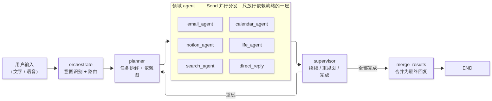
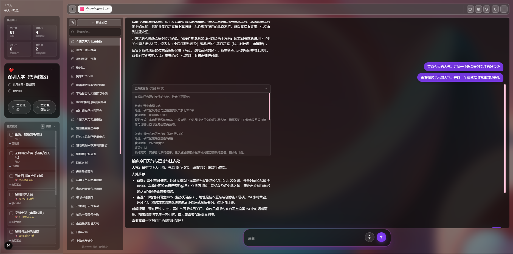

<div align="center">

# LifePilot

**个人 AI 多智能体生活自动化管家**

替你打理"生活行政事务"：邮件会议邀请提取、日程安排、主动提醒、长期记忆、任务规划、天气/地图/联网搜索，可选接入腾讯会议。
所有会产生真实副作用的动作（发邮件、改任务）都走**人工确认**——agent 只负责起草和提议，等你点确认才执行。


</div>

---

## 目录

- [它能做什么](#它能做什么)
- [一次请求的完整链路](#一次请求的完整链路)
- [技术栈](#技术栈)
- [核心模块](#核心模块)
- [界面预览](#界面预览)
- [项目结构](#项目结构)
- [快速开始](#快速开始)
- [环境变量](#环境变量)
- [使用示例](#使用示例)
- [运行测试](#运行测试)
- [License](#license)

---

## 它能做什么

给它一句话，比如：

> "用我保存的偏好和长期记忆，帮我排出接下来最重要的三件事。"

LifePilot 会把这句话拆成有依赖关系的计划，把可并行的步骤分发给领域 agent 同时执行，监督执行结果，对受阻的步骤重新规划，最后把计划里的任务写回任务看板。

| 能力 | 说明 |
|---|---|
| **163 邮箱登录与收发** | 用 `MAIL163_EMAIL` + `MAIL163_EMAIL_AUTH_CODE` 登录，IMAP 收信、SMTP 发信 |
| **Planner + Supervisor 编排** | 依赖感知的任务分解、并行扇出、动态重规划，`plan_id` 与计划元数据落库 |
| **人工确认（HITL）** | 发邮件 / 回邮件 / 改任务 / 删任务先落 `PendingAction` 草案，载荷冻结、前端渲染确认卡片，`approve` 才真正执行 |
| **会议邀请提取** | 从类邮件文本里解析会议时间、会议号、入会链接，自动创建会前提醒；收件箱每 5 分钟自动扫描，邀约落到任务看板（按邮件 `Message-ID` 幂等） |
| **腾讯会议 API**（可选） | 查询 / 创建 / 更新会议，创建具备幂等性 |
| **主动提醒** | 截止时间、会议、定时任务、手动提醒；APScheduler 每分钟轮询，到点投递为站内通知；任务标记完成后自动取消未触发的提醒 |
| **长期记忆** | PostgreSQL + pgvector + VoyageAI 向量化，Redis 缓存检索；精确查重 → LLM 增量决策（新增/更新/删除/跳过）→ 软删除旧值，支持用户画像与偏好/习惯库 |
| **生活服务** | 天气与地图默认 Open-Meteo / Nominatim（免 key），可切换高德（国内推荐，含路线规划）/ OpenWeatherMap / Google Maps |
| **联网搜索与旅行规划** | Tavily 搜索攻略/最新信息；旅行类请求自动展开为天气 / 景点 / 交通三个并行步骤再汇总 |
| **定时任务** | cron 风格的循环 agent 运行，带运行历史、结果判定与执行 trace |
| **可靠性** | Redis 幂等键、任务创建锁 + 数据库唯一索引双保险、LangGraph Postgres checkpoint、失败重试与重规划监督 |
| **语音输入** | SiliconFlow SenseVoiceSmall 语音转写 + Edge TTS 播报 |

---

## 一次请求的完整链路



- **读操作**：结果直接合并成回复返回。
- **写操作**：产出 `PendingAction` 草案卡片 ──► 等用户确认 ──► 真正执行。

几条硬性约束：

- 发邮件 / 回邮件 / 改任务 / 删任务一律先出草案，经用户确认后才执行；执行只读冻结的 payload，不重新解析对话文本
- 节点之间只通过 `AgentState` 通信，不互相直接调用函数
- 外部 API 一律走工具封装（`backend/agents/tools/`），节点内不出现裸调用
- 每轮对话使用独立 `thread_id`，避免上一轮的中间状态污染本轮
- 失败步骤会阻断传递依赖的下游步骤，"查不到的数据"绝不会被拿去写邮件

---

## 技术栈

| 层次 | 技术 |
|---|---|
| 前端 | Next.js 16（App Router）、React 19、Tailwind CSS 4、React Query |
| 后端 | FastAPI、Python 3.11+、SQLAlchemy（async） |
| Agent 编排 | LangGraph planner / supervisor 状态图（`Send` 并行扇出） |
| 工具封装 | LangChain `@tool` 工具集（`backend/agents/tools/`） |
| 大模型 | OpenRouter / OpenAI 兼容接口（可配置模型，默认 `anthropic/claude-sonnet-4.6`） |
| 向量化 | VoyageAI（`voyage-3`） |
| 数据库 | PostgreSQL 15+ 带 `pgvector` |
| 缓存 | Redis（记忆缓存、幂等键；未配置时降级为仅数据库兜底） |
| 调度 | APScheduler（提醒 tick / 定时任务 / 收件箱监听 / 每日画像总结） |
| 邮件 | 163 授权码登录 + IMAP 收信 / SMTP 发信 |
| 语音 | SiliconFlow SenseVoiceSmall STT + Edge TTS |
| 可观测 | LangSmith / Langfuse 全链路追踪（可选，未配置自动降级为 no-op） |

---

## 核心模块

| 模块 | 位置 | 实现逻辑 |
|---|---|---|
| 意图编排 | `backend/agents/orchestrator_node.py` | 把一句话拆成 1~5 个意图并路由（email / calendar / notion / life / search / direct）；确认卡片回复（approve/reject）直接短路，不调 LLM |
| 规划器 | `backend/agents/planner_agent_node.py` | LLM 产出带 `depends_on` 的 JSON 计划，校验路由、优先级、依赖（上限 8 步）后把步骤落库成任务；`due_at` 自动挂截止提醒；旅行类请求展开为天气/景点/交通三步并行 |
| 并行分发 | `backend/agents/graph.py` | LangGraph `StateGraph` + `Send`，`_fan_out` 只分发"依赖已完成"的下一层任务 |
| 监督代理 | `backend/agents/supervisor_node.py` | 判定 continue / replan / done；失败时阻断传递依赖的下游步骤并生成「已暂停的步骤」提示；致命错误（地点不存在等）直接短路，不做无意义的重规划 |
| 领域代理与工具 | `backend/agents/*_agent_node.py`、`backend/agents/tools/` | 邮件 / 日历 / Notion / 生活服务 / 搜索各自封装，写操作只产出 `PendingAction` 回执，不直接执行 |
| 人工确认（HITL） | `backend/models/pending_action.py`、`backend/services/pending_action_service.py` | 草案冻结为 `payload` JSONB，`POST /pending-actions/{id}/approve` 按冻结载荷执行（注入免疫）；7 天过期，拒绝/过期状态机闭环 |
| 长期记忆 | `backend/services/memory_service.py` | VoyageAI 向量 + pgvector 余弦检索（带距离阈值）+ 关键词 CJK bigram 兜底，两路取并集；Redis 缓存按 query 分片；一次性情绪/流水账由 `memory_noise_filter` 硬闸门拦截 |
| 提醒与调度 | `backend/services/reminder_service.py`、`backend/jobs/` | APScheduler：每 1 分钟 tick 投递到期提醒（`FOR UPDATE SKIP LOCKED`）并推进 cron 定时任务；每 5 分钟收件箱监听；每日 03:00 用户画像总结 |
| 会议邀约 | `backend/services/meeting_invite_extraction.py`、`meeting_invite_scanner.py`、`inbox_listener.py` | 正则优先、LLM 兜底提取会议时间/会议号/入会链接；收件箱扫描把邀约投影到唯一任务卡（按 `Message-ID` 幂等），非模板邮件走 LLM 事件抽取 |
| 生活服务 | `backend/services/life_service_client.py` | Open-Meteo / Nominatim 免 key 默认；高德支持 adcode 解析、POI 城市限定搜索、步行/公交/驾车路线规划；带实体一致性校验，模糊错配（如「火星→火星村」）直接报 `fatal_error` 短路 |
| 任务幂等 | `backend/services/idempotency_service.py`、`backend/services/task_service.py` | Redis `SET NX` 创建锁（user+title+due_at，300s TTL）+ `tasks` 部分唯一索引兜底，并发规划不会重复建卡 |
| 可观测 | `backend/services/langsmith_tracing.py`、`langfuse_tracing.py` | 图级 callback 捕获节点耗时、LLM 用量与工具调用；缺 key / 缺包时安全降级，不影响聊天链路 |

---

## 界面预览

### 思考轨迹（Thought Trace）

每条回复上方都有一个可展开的「已深度思考（用时 …）」面板，记录 agent 本轮的分步推理与工具调用轨迹。生成过程中自动展开、实时滚动，答完后默认折叠，点一下就能看清它为什么这么答。



### LifePilot 工作区

今日回顾会自动生成晨报——今天的日程、已回复的邮件、即将到期的任务、已发送的提醒，外加长期记忆库与偏好设置。


### 人工确认（HITL）

会发出真实动作的请求，先把草案渲染成卡片——收件人、主题、正文一目了然，底部「确认执行 / 拒绝」。在你点确认之前，邮件不会发出去。


<details>
<summary><strong>更多界面截图</strong>（登录 / 日历 / 通知中心 / 任务看板 / 生活服务 / Notion）</summary>

#### 登录

邮箱 + 163 授权码登录，首次登录后即可收发邮件与触发提醒。


#### 日历与邀约

本地日程（`.ics` 导入）、任务截止时间和从邮件里提取的会议邀请，统一落在同一个日历视图里。


#### 通知中心

「邮箱」栏汇总最近的邮件与提醒，「提醒」栏里每条都能一键**转成任务**，进入任务看板继续跟踪。邮件里出现重要事项时，会弹出气泡提醒，可直接转成任务或稍后提醒。


#### 任务看板与任务详情

左侧「未完成」、右侧「已完成」，卡片支持转任务 / 打开 / 删除，按项目分组展示。点开卡片可以看完整描述、截止时间、所属项目、来源和依赖关系。


#### 生活服务

按城市查天气、按地名查位置与路线，每次调用都会沉淀成可追溯的记录。


#### 写入 Notion

agent 可以通过 Notion 工具在已授权的页面里搜索与写入内容，并把写入结果连同链接直接回在对话里。


</details>

---

## 项目结构

```
chief-of-staff/
├── frontend/               # Next.js 应用
│   ├── app/                # /, /tasks, /notifications, /background-jobs, /calendar, /life-pilot
│   ├── components/         # 工作区、看板、聊天、确认卡片等 UI
│   ├── hooks/              # 每个 API 资源对应的 React Query hook
│   └── lib/                # 鉴权会话、带 token 的 fetch、本地存储工具
│
├── backend/                # FastAPI 服务
│   ├── routers/            # HTTP 接口（auth、chat、voice、mail163、calendar、notion、
│   │                       #   notifications、background-jobs、tasks、reminders、
│   │                       #   pending-actions、life-services、memory、meeting-invites …）
│   ├── agents/             # LangGraph planner / supervisor 编排与工具封装
│   │   └── tools/          # 领域工具（邮件、日历、Notion、生活服务、提醒、任务 …）
│   ├── models/             # SQLAlchemy ORM 模型
│   ├── schemas/            # Pydantic 请求/响应模型
│   ├── services/           # 业务逻辑（记忆、提醒、邀约、幂等、HITL、追踪 …）
│   ├── jobs/               # APScheduler 定时任务（提醒 tick、定时任务 tick、画像总结）
│   ├── auth/               # JWT 签发与鉴权依赖
│   ├── db/                 # 会话、schema 迁移、常量
│   ├── tests/              # unittest 测试集，含全链路用例与 evaluation 子集
│   └── run.py              # 启动入口（见下方"快速开始"的说明）
│
└── doc/image/              # README 截图
```

---

## 快速开始

### 前置条件

- Node.js 20.9+
- Python 3.11+
- PostgreSQL 15+ 且安装 `pgvector` 扩展
- Redis（建议；未配置时记忆缓存与幂等锁降级为数据库兜底）

### 后端

```powershell
cd backend

# 创建虚拟环境并安装依赖
python -m venv .venv
.\.venv\Scripts\python.exe -m pip install -e .

# 准备配置
copy .env.example .env
# 填入 DATABASE_URL、JWT_SECRET、OPENROUTER_API_KEY、REDIS_URL、MAIL163_* 等

# 启动
.\.venv\Scripts\python.exe run.py
```

macOS / Linux 上把最后两步换成：

```bash
source .venv/bin/activate
python run.py
```

服务地址由 `backend/.env` 的 `API_HOST` / `API_PORT` 决定（示例配置是 `0.0.0.0:8081`）。

> [!IMPORTANT]
> **必须用 `run.py` 启动，不要用 `python -m uvicorn main:app`。**
> psycopg 的异步驱动只能跑在 `SelectorEventLoop` 上；Windows 下 uvicorn 默认走 `ProactorEventLoop`，且 uvicorn 0.36+ 通过 `asyncio.run(..., loop_factory=...)` 建循环，`asyncio.set_event_loop_policy()` 对它无效。用 `python -m uvicorn` 直接起会**静默降级成内存版 checkpointer**（日志里出现 `Postgres checkpointer unavailable ... falling back to in-memory`），LangGraph 的中间状态就不再落库。
>
> 相应地 `run.py` 里写死了 `reload=False`。改完后端代码需要手动重启一次。

`INIT_DB_SCHEMA_ON_STARTUP=true` 时，启动会自动建表（含 `CREATE EXTENSION IF NOT EXISTS vector`）并补齐后台任务、任务列与 LifePilot 相关字段。

### 前端

```bash
cd frontend
npm install

cp .env.example .env
# 设置 NEXT_PUBLIC_API_BASE_URL=http://localhost:8081（与后端 API_PORT 保持一致）

npm run dev
```

打开 `http://localhost:3000`，LifePilot 面板在 `/life-pilot`。

---

## 环境变量

### 后端（`backend/.env`，完整清单见 `backend/.env.example`）

**核心必需**

| 变量 | 说明 |
|---|---|
| `DATABASE_URL` | PostgreSQL 异步连接串（`postgresql+asyncpg://...`） |
| `JWT_SECRET` | 会话签名密钥，建议 32 位以上随机串 |
| `OPENROUTER_API_KEY` | 大模型 API key（OpenRouter 或任意 OpenAI 兼容接口） |
| `MAIL163_EMAIL` | 163 邮箱地址，登录/收发邮件必需 |
| `MAIL163_EMAIL_AUTH_CODE` | 163 邮箱授权码（需先在邮箱设置中开启 IMAP/SMTP） |

**可选服务集成**

| 变量 | 说明 |
|---|---|
| `OPENROUTER_BASE_URL` | 默认 `https://openrouter.ai/api/v1`；也可指向 DeepSeek 等 OpenAI 兼容接口 |
| `OPENROUTER_DEFAULT_MODEL` | 主对话模型，默认 `anthropic/claude-sonnet-4.6` |
| `OPENROUTER_MAX_TOKENS` | 预留 completion token 上限（默认 2048），防止低余额账户 402 |
| `CHAT_THINKING_MODE` | DeepSeek 思考模式开关，默认 `false`（与多轮工具调用不兼容） |
| `REDIS_URL` | 默认 `redis://localhost:6379/0`；未设置则关闭缓存/幂等锁 |
| `NOTION_CLIENT_ID` / `NOTION_CLIENT_SECRET` | Notion OAuth 接入 |
| `NOTION_API_KEY` | Notion 内部集成 token（`ntn_` 开头），免 OAuth 直接读写已共享页面 |
| `VOYAGEAI_API_KEY` | 记忆/RAG 向量化（`VOYAGEAI_MODEL` 默认 `voyage-3`） |
| `SILICONFLOW_API_KEY` | 语音转写（SenseVoiceSmall） |
| `TENCENT_MEETING_APP_ID` / `TENCENT_MEETING_SECRET_ID` / `TENCENT_MEETING_SECRET_KEY` | 腾讯会议 REST API |
| `TAVILY_API_KEY` | 联网搜索（旅行攻略/最新信息），未配置则少一路 search |
| `LANGSMITH_API_KEY` / `LANGFUSE_PUBLIC_KEY` + `LANGFUSE_SECRET_KEY` | 全链路追踪，可同时启用，未配置自动关闭 |

**生活服务**

| 变量 | 说明 |
|---|---|
| `WEATHER_PROVIDER` | `amap` / `openweathermap`；其他值（默认）走 Open-Meteo（免 key） |
| `MAP_PROVIDER` | `amap` / `google_maps`；其他值（默认）走 Nominatim（免 key） |
| `AMAP_API_KEY` | 高德 key；国内环境推荐 `WEATHER_PROVIDER=amap` + `MAP_PROVIDER=amap`（含路线规划） |
| `OPENWEATHER_API_KEY` / `GOOGLE_MAPS_API_KEY` | 对应付费 provider 的密钥 |
| `WEATHER_DEFAULT_CITY` | 未点名城市时的默认地点（默认 `Shanghai`） |

**运行与调度**

| 变量 | 说明 |
|---|---|
| `API_HOST` / `API_PORT` | 监听地址与端口，示例 `0.0.0.0` / `8081` |
| `CORS_ALLOWED_ORIGINS` | 允许的前端来源，逗号分隔 |
| `INIT_DB_SCHEMA_ON_STARTUP` | 设为 `true` 时启动自动建表并补齐字段 |
| `DATABASE_POOL_SIZE` / `DATABASE_MAX_OVERFLOW` | 连接池大小（聊天 SSE 会长时间占用会话，默认 10/20） |
| `PLANNER_TIMEZONE` | 规划/提醒引擎使用的用户本地时区（如 `Asia/Shanghai`，默认 `UTC`） |
| `REMINDER_DEFAULT_LEAD_MINUTES` | 截止提醒提前量（默认 30 分钟） |
| `LANGGRAPH_CHECKPOINTER` | 设为 `postgres` 启用持久化 checkpointer；不设为进程内内存版 |
| `MAIL163_SMTP_HOST` / `MAIL163_SMTP_PORT` / `MAIL163_IMAP_HOST` / `MAIL163_IMAP_PORT` | 默认 `smtp.163.com:465`、`imap.163.com:993` |

### 前端（`frontend/.env`）

| 变量 | 是否必需 | 说明 |
|---|---|---|
| `NEXT_PUBLIC_API_BASE_URL` | 是 | 后端地址，需与 `API_PORT` 一致（`http://localhost:8081`） |

---

## 使用示例

**登录**：前端登录页填 163 邮箱 + 授权码，等价于访问后端 `GET /mail163/login`——用 IMAP 校验授权码，复用邮箱地址创建/获取用户并签发 JWT。

**对话**：像发消息一样说一句话即可，回复以 SSE 流式返回，思考轨迹面板实时展示规划与工具调用：

```
> 帮我看看明天上海天气怎么样，如果下雨就把周六的外出任务改到周日
```

agent 会拆成「查天气 → 改任务」两步：天气步骤完成后带着结果执行任务更新；任务更新属于写操作，会先弹出确认卡片。

**人工确认**：草案以 `pending_action` 事件推给前端渲染成卡片；也可以直接调接口：

```bash
# 查看待确认草案
curl -H "Cookie: <session>" http://localhost:8081/pending-actions

# 确认执行（执行的是冻结的 payload，拒绝则状态置为 REJECTED）
curl -X POST -H "Cookie: <session>" http://localhost:8081/pending-actions/<action_id>/approve
```

**会议邀约自动上板**：收件箱监听每 5 分钟扫描一次，识别出会议/邀约后自动创建任务卡并发站内通知；也可以手动触发 `POST /meeting-invites/scan-inbox`。

**记忆**：聊天中随口说的长期事实（"我最喜欢喝美式"）会自动入库并第三人称化；说"我其实更喜欢喝拿铁"会软删除旧偏好，而不是新旧并存。

---

## 运行测试

后端使用 Python 内置的 `unittest`：

```bash
cd backend
.venv/Scripts/python.exe -m unittest discover -s tests -p "test_*.py"
```

测试集包含 LifePilot 全链路用例，覆盖：邮件会议提取、会议自动提醒、计划任务落库、截止提醒、提醒轮询投递、任务完成后的提醒清理、HITL 草案与发送声明校验、任务创建幂等、记忆去重与噪声过滤等。

`backend/tests/evaluation/` 下的真实后端评估用例（真实 LLM + 真实 Postgres）默认跳过，设置 `RUN_EVALUATION_TESTS=1` 并配好 `DATABASE_URL` / `OPENROUTER_API_KEY` / `VOYAGEAI_API_KEY` 后才会运行，避免平时跑测试消耗 LLM 额度。

前端类型检查：

```bash
cd frontend
npx tsc --noEmit
```

---

<div align="center">

**License**

MIT

</div>
