# LifePilot — 个人 AI 多智能体生活自动化管家

LifePilot 是一个替你打理"生活行政事务"的个人 AI 智能体：从邮件里提取会议邀请、安排日程、主动提醒、长期记忆、任务规划，以及天气/地图查询，可选接入腾讯会议。所有会产生真实副作用的动作（发邮件、写 Notion、建日程）都走**人工确认**——agent 只负责起草和提议，等你点确认才执行。

---

## 目录

- [界面预览](#界面预览)
- [它能做什么](#它能做什么)
- [一次请求的完整链路](#一次请求的完整链路)
- [技术栈](#技术栈)
- [项目结构](#项目结构)
- [快速开始](#快速开始)
- [环境变量](#环境变量)
- [运行测试](#运行测试)
- [License](#license)

---

## 界面预览

### 首页与今日概览

左栏是「今天·概览」（待办数、执行中、逾期、已完成）、待办提醒卡和任务箱；中栏是对话入口与历史会话；底部可一键发起「邮件整理 / 日历概览 / 提取邀请 / 生活服务 / 规划今天」。

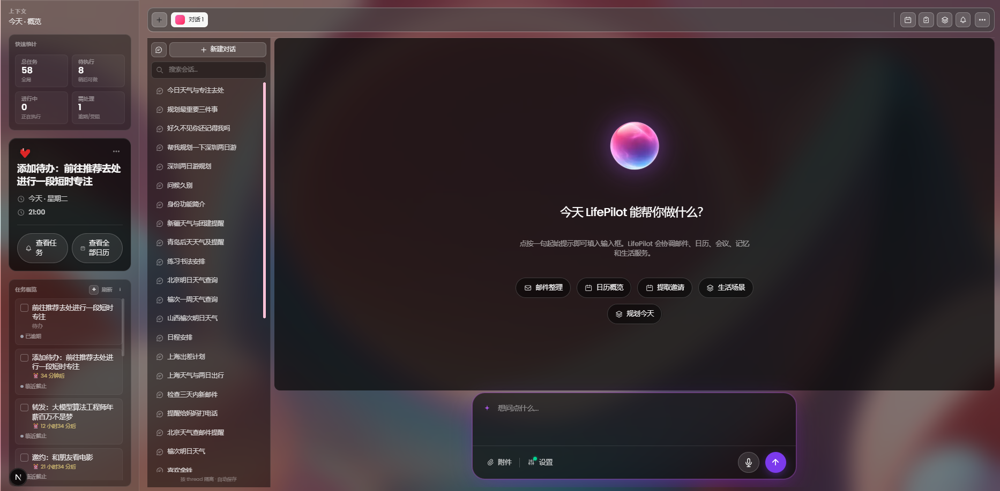

### 登录

邮箱 + 163 授权码登录，不走 Google OAuth 授权页。


### LifePilot 工作区

今日回顾会自动生成晨报——今天的日程、已回复的邮件、即将到期的任务、已发送的提醒，外加长期记忆库与偏好设置。

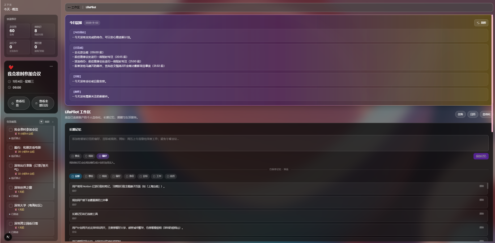

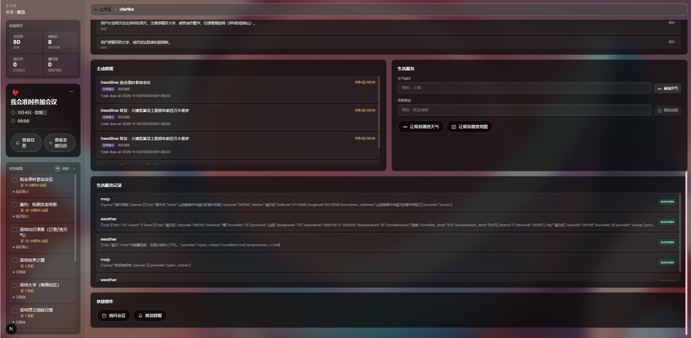

### 人工确认（HITL）

会发出真实动作的请求，先把草案渲染成卡片——收件人、主题、正文一目了然，底部「确认执行 / 拒绝」。在你点确认之前，邮件不会发出去。

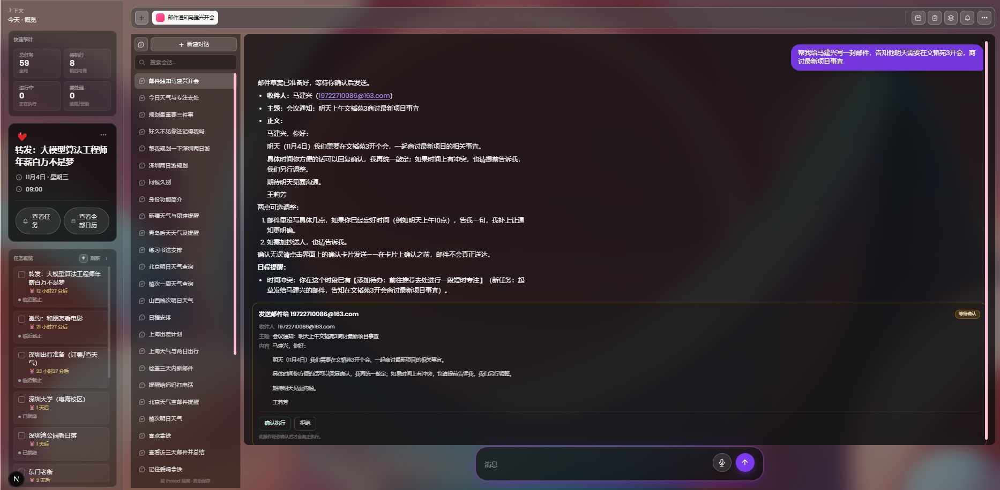

### 日历与邀约

本地日程、任务截止时间和从邮件里提取的会议邀请，统一落在同一个日历视图里。

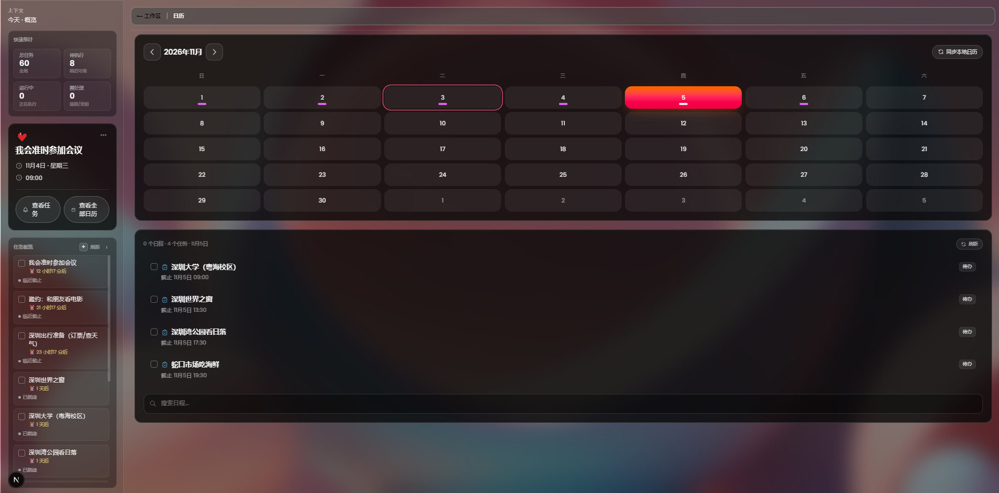

### 通知中心

「邮箱」栏汇总最近的邮件与提醒，「提醒」栏里每条都能一键**转成任务**，进入任务看板继续跟踪。

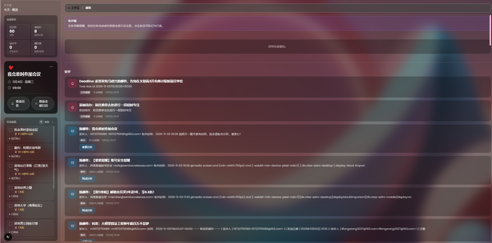

邮件里出现重要事项时，会弹出气泡提醒，可直接转成任务或稍后提醒。

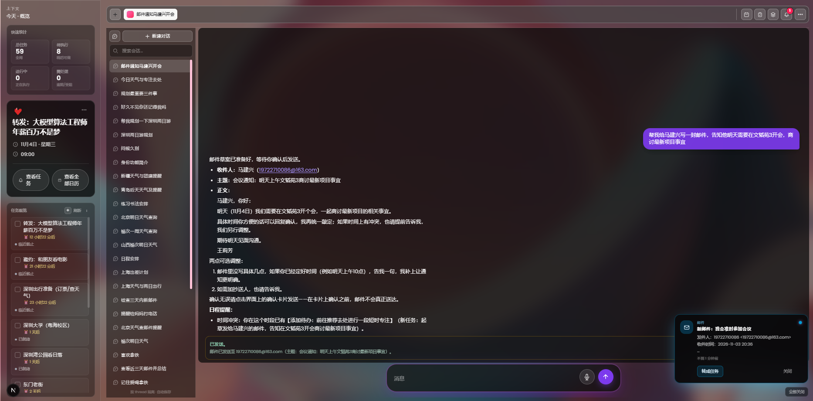

### 任务看板

左侧「未完成」、右侧「已完成」，卡片支持转任务 / 打开 / 删除，按项目分组展示。

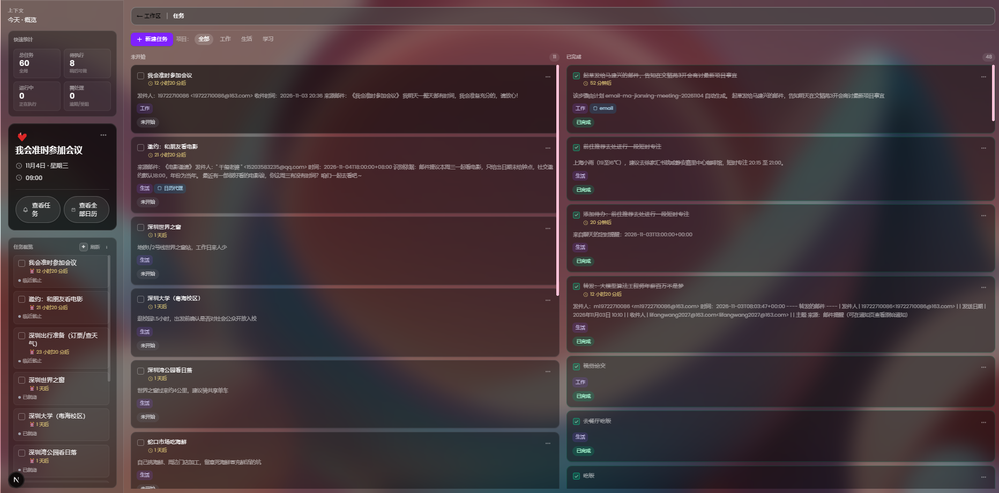

### 任务详情

点开卡片可以看完整描述、截止时间、所属项目、来源和依赖关系。

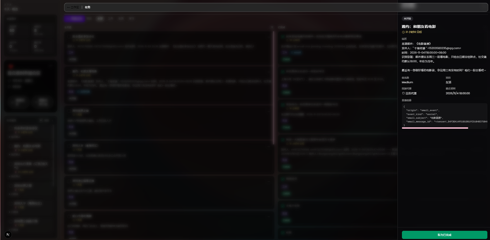

### 生活服务

按城市查天气、按地名查位置与路线，每次调用都会沉淀成可追溯的记录。

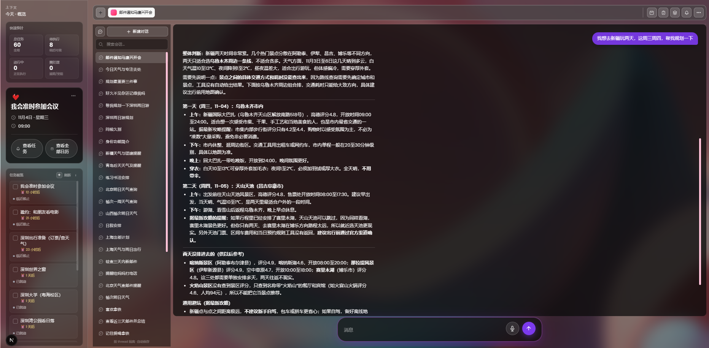

### 写入 Notion

"把这份总结写进 Notion"——同样先出草案，确认后才真正写入。

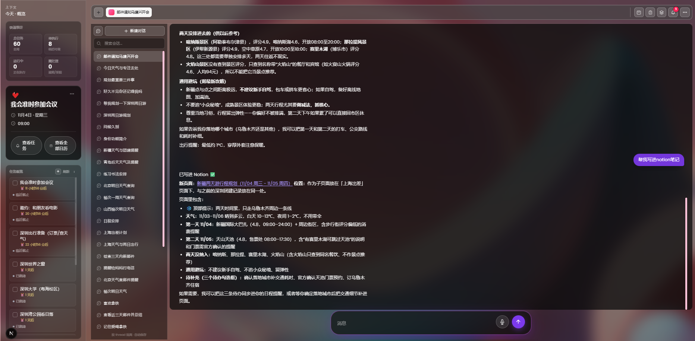

---

## 它能做什么

给它一句话，比如：

> "用我保存的偏好和长期记忆，帮我排出接下来最重要的三件事。"

LifePilot 会把这句话拆成有依赖关系的计划，把可并行的步骤分发给领域 agent 同时执行，监督执行结果，对受阻的步骤重新规划，最后把计划里的任务写回任务看板。

主要能力：

- **163 邮箱登录与收发** — 用 `backend/.env` 里的 `MAIL163_EMAIL` + `MAIL163_EMAIL_AUTH_CODE` 登录，IMAP 收信、SMTP 发信，不需要 Google 授权页
- **Planner + Supervisor 编排** — 依赖感知的任务分解、并行扇出、动态重规划，`plan_id` 与计划元数据落库
- **会议邀请提取** — 从类邮件文本里解析会议时间、会议号、入会链接与原文，自动创建会前提醒
- **腾讯会议 API**（可选）— 查询 / 创建 / 更新会议，创建具备幂等性
- **主动提醒** — 截止时间、会议、定时任务、手动提醒；APScheduler 每分钟轮询一次，到点投递为站内通知。任务一旦标记完成，其尚未触发的提醒会被自动取消
- **长期记忆** — PostgreSQL + pgvector + VoyageAI 向量化，Redis 缓存检索结果，支持用户画像摘要与偏好/习惯库
- **生活服务** — 天气与地图默认走 Open-Meteo / Nominatim，可切换 OpenWeatherMap / Google Maps
- **定时任务** — cron 风格的循环 agent 运行，带运行历史、结果判定与执行 trace
- **可靠性** — Redis 幂等键、LangGraph checkpoint、失败重试与重规划监督、任务进度追踪
- **语音输入** — SiliconFlow SenseVoiceSmall 语音转写 + Edge TTS 播报

---

## 一次请求的完整链路

```
用户输入
   │
   ▼
意图识别 ──► 规划器（拆解成有依赖的任务）
   │
   ▼
领域 agent 并行执行（邮件 / 日历 / 生活服务 / 记忆 / 提醒 …）
   │
   ▼
监督代理：成功→标记完成；失败/受阻→重排重试
   │
   ├──► 读操作：直接返回结果并生成回复
   │
   └──► 写操作：产出草案卡片 ──► 等用户确认 ──► 真正执行
                                        │
                                        ▼
                              任务状态写回任务看板
```

几条硬性约束：

- 写操作必须经过确认节点，不存在"直接发出"的路径
- 节点之间只通过 `AgentState` 通信，不互相直接调用函数
- 外部 API 一律走工具封装，节点内不出现裸调用
- 每轮对话使用独立 `thread_id`，避免上一轮的中间状态污染本轮

---

## 技术栈

| 层次 | 技术 |
|---|---|
| 前端 | Next.js（App Router）、Tailwind CSS、React Query |
| 后端 | FastAPI、Python 3.11+、SQLAlchemy（async） |
| Agent 编排 | LangGraph planner / supervisor 状态图 |
| 工具集成 | MCP（Model Context Protocol） |
| 大模型 | OpenRouter（可配置模型） |
| 向量化 | VoyageAI |
| 数据库 | PostgreSQL 15+ 带 `pgvector` |
| 缓存 | Redis |
| 邮件 | 163 授权码登录 + IMAP 收信 / SMTP 发信 |
| 语音 | SiliconFlow SenseVoiceSmall STT + Edge TTS |

---

## 项目结构

```
chief-of-staff/
├── frontend/               # Next.js 应用
│   ├── app/                # /, /tasks, /notifications, /background-jobs, /calendar, /life-pilot
│   ├── components/         # 工作区、看板、聊天 UI
│   ├── hooks/              # 每个 API 资源对应的 React Query hook
│   └── lib/                # 鉴权、带 token 的 fetch、本地存储工具
│
├── backend/                # FastAPI 服务
│   ├── routers/            # HTTP 接口（chat、tasks、reminders、life-services、memory …）
│   ├── agents/             # LangGraph planner / supervisor 编排与工具封装
│   ├── models/             # SQLAlchemy ORM 模型
│   ├── schemas/            # Pydantic 请求/响应模型
│   ├── services/           # 业务逻辑
│   ├── jobs/               # APScheduler 定时任务
│   ├── db/                 # 会话、迁移、常量
│   └── tests/              # unittest 测试集，含全链路用例
│
└── doc/image/              # README 截图
```

---

## 快速开始

### 前置条件

- Node.js 20+
- Python 3.11+
- PostgreSQL 15+ 且安装 `pgvector` 扩展
- Redis

### 后端

```powershell
cd backend

# 创建虚拟环境并安装依赖
python -m venv .venv
.\.venv\Scripts\python.exe -m pip install -e .

# 准备配置
copy .env.example .env
# 填入 DATABASE_URL、JWT_SECRET、OPENROUTER_API_KEY、REDIS_URL、MAIL163_* 等

# 启动
.\.venv\Scripts\python.exe run.py
```

macOS / Linux 上把最后两步换成：

```bash
source .venv/bin/activate
python run.py
```

服务地址由 `backend/.env` 的 `API_HOST` / `API_PORT` 决定（示例配置是 `0.0.0.0:8001`）。

> **必须用 `run.py` 启动，不要用 `python -m uvicorn main:app`。**
> psycopg 的异步驱动只能跑在 `SelectorEventLoop` 上；Windows 下 uvicorn 默认走 `ProactorEventLoop`，且 uvicorn 0.36+ 通过 `asyncio.run(..., loop_factory=...)` 建循环，`asyncio.set_event_loop_policy()` 对它无效。用 `python -m uvicorn` 直接起会**静默降级成内存版 checkpointer**（日志里出现 `Postgres checkpointer unavailable ... falling back to in-memory`），LangGraph 的中间状态就不再落库。
>
> 相应地 `run.py` 里写死了 `reload=False`。改完后端代码需要手动重启一次。

`INIT_DB_SCHEMA_ON_STARTUP=true` 时，启动会自动建表并补齐 LifePilot 相关字段。

### 前端

```bash
cd frontend
npm install

cp .env.example .env
# 设置 NEXT_PUBLIC_API_BASE_URL=http://localhost:8001（与后端 API_PORT 保持一致）

npm run dev
```

打开 `http://localhost:3000`，LifePilot 面板在 `/life-pilot`。

---

## 环境变量

### 后端（`backend/.env`）

| 变量 | 是否必需 | 说明 |
|---|---|---|
| `DATABASE_URL` | 是 | PostgreSQL 异步连接串（`postgresql+asyncpg://...`） |
| `JWT_SECRET` | 是 | 会话签名密钥，建议 32 位以上随机串 |
| `OPENROUTER_API_KEY` | 是 | 通过 OpenRouter 访问大模型 |
| `REDIS_URL` | 是 | Redis 地址（`redis://localhost:6379/0`） |
| `MAIL163_EMAIL` | 登录/收发邮件必需 | 163 邮箱地址，例如 `user@163.com` |
| `MAIL163_EMAIL_AUTH_CODE` | 登录/收发邮件必需 | 163 邮箱授权码（需先在邮箱设置中开启 IMAP/SMTP） |
| `MAIL163_SMTP_HOST` | 可选 | 默认 `smtp.163.com` |
| `MAIL163_SMTP_PORT` | 可选 | 默认 `465` |
| `MAIL163_IMAP_HOST` | 可选 | 默认 `imap.163.com` |
| `MAIL163_IMAP_PORT` | 可选 | 默认 `993` |
| `GOOGLE_CLIENT_ID` | 旧版 Gmail/日历 | Google OAuth client ID（前端已改用 163 登录） |
| `GOOGLE_CLIENT_SECRET` | 旧版 Gmail/日历 | Google OAuth client secret |
| `NOTION_CLIENT_ID` | 接入 Notion 需要 | Notion OAuth client ID |
| `NOTION_CLIENT_SECRET` | 接入 Notion 需要 | Notion OAuth client secret |
| `VOYAGEAI_API_KEY` | 记忆/RAG 需要 | VoyageAI 向量化 |
| `SILICONFLOW_API_KEY` | 语音功能需要 | SiliconFlow SenseVoiceSmall |
| `TENCENT_MEETING_APP_ID` | 可选 | 腾讯会议 REST API app ID |
| `TENCENT_MEETING_SECRET_ID` | 可选 | 腾讯会议 secret ID |
| `TENCENT_MEETING_SECRET_KEY` | 可选 | 腾讯会议 secret key |
| `WEATHER_PROVIDER` | 可选 | `open_meteo`（默认）或 `openweathermap` |
| `MAP_PROVIDER` | 可选 | `nominatim`（默认）或 `google_maps` |
| `OPENWEATHER_API_KEY` | 用 OpenWeatherMap 时需要 | 天气服务密钥 |
| `GOOGLE_MAPS_API_KEY` | 用 Google Maps 时需要 | 地图服务密钥 |
| `API_HOST` / `API_PORT` | 可选 | 监听地址与端口，示例 `0.0.0.0` / `8001` |
| `INIT_DB_SCHEMA_ON_STARTUP` | 可选 | 设为 `true` 时启动自动建表 |
| `CORS_ALLOWED_ORIGINS` | 可选 | 允许的前端来源，逗号分隔 |

### 前端（`frontend/.env`）

| 变量 | 是否必需 | 说明 |
|---|---|---|
| `NEXT_PUBLIC_API_BASE_URL` | 是 | 后端地址，需与 `API_PORT` 一致（`http://localhost:8001`） |

---

## 运行测试

后端使用 Python 内置的 `unittest`：

```bash
cd backend
.venv/Scripts/python.exe -m unittest discover -s tests -p "test_*.py"
```

测试集包含 LifePilot 全链路用例，覆盖：邮件会议提取、会议自动提醒、计划任务落库、截止提醒、提醒轮询投递、任务完成后的提醒清理、幂等往返等。

前端类型检查：

```bash
cd frontend
npx tsc --noEmit
```

---

## License

MIT
